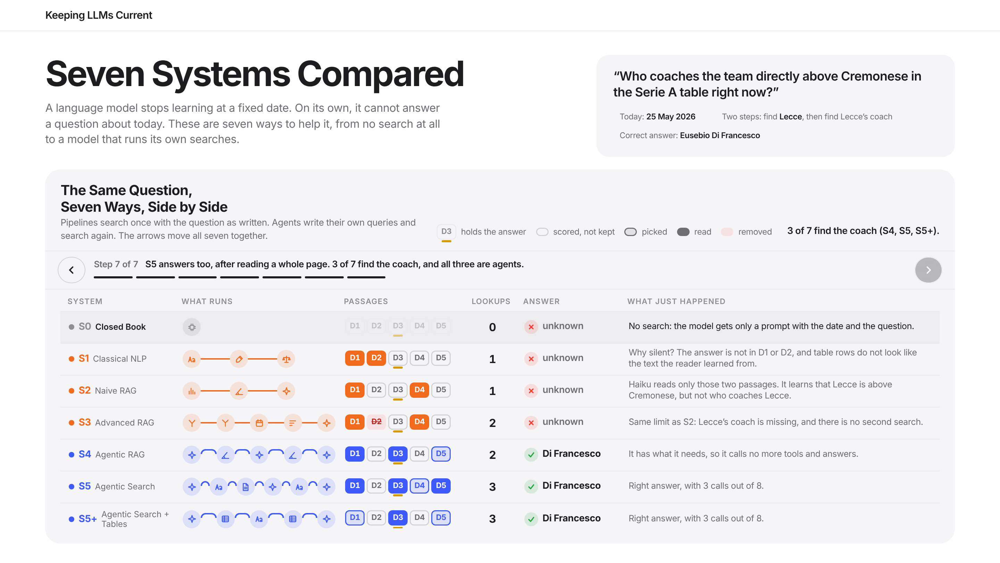

# Keeping LLMs Current: From NLP to Agentic Search on Serie A

Seven question-answering systems answer 120 questions about Serie A at two dates, t0 = 1 September 2025
and t1 = 25 May 2026, and for many questions the right answer changes in between. The systems that search
read English Wikipedia as it was on that date.

- S0 closed book: the LLM answers from memory, without searching
- S1 classical NLP: a keyword search, then a small model underlines the answer (no LLM)
- S2 naive RAG: one search by meaning, then the LLM answers from what it found
- S3 advanced RAG: both searches together, only the right season, the best passages first
- S4 agentic RAG: the LLM searches by meaning as many times as it needs
- S5 agentic search: the same agent, searching by keywords
- S5+ agentic search + tables: S5 that can also read the official league tables

## Interactive page

[](https://alexcambier.github.io/seriea-agentic-search/)

**[Open the interactive page](https://alexcambier.github.io/seriea-agentic-search/)**: it follows one question, "Who coaches
the team directly above Cremonese in the Serie A table right now?", through all seven systems, first side by side
and then block by block. Use the arrows or the ← → keys. The page is docs/index.html, a single file with no
dependencies.

The code is in code/:

- systems.py: the seven systems, each answering a question at t0 or t1
- experiment.py: the commands run and repeat (the systems answer) and evaluate (the judge grades the answers,
  then the results are written in results/)
- report.py: results/answers.tsv and the sections of results/report.md, with the statistics they use (the 95%
  intervals, the kinds of wrong answer)
- figures.py: the five figures of Chapter 6
- app.py: a web page to try the systems

The data they read is in data/.

## Setup (Python 3.12)

Run every command from the project folder, the one with this README.

```
python -m venv .venv
.venv/bin/pip install requests==2.34.2 beautifulsoup4==4.15.0 lxml==6.1.3 pandas==3.0.6 pyyaml==6.0.3 \
    anthropic==1.8.0 bm25s==0.3.11 sentence-transformers==6.1.0 transformers==5.17.0 torch==2.14.0 \
    numpy==2.5.3 matplotlib==3.11.2 gradio==6.28.0
```

The first run downloads three small models from Hugging Face into ~/.cache/huggingface; after that they work offline.

Put the API keys in a file named .env in the project folder (.gitignore keeps it out of git). Each key needs
`export` in front of it, or Python will not see it:

```
export ANTHROPIC_API_KEY=...      # steps 4 and 5
export FOOTBALL_DATA_TOKEN=...    # only to download the matches again (step 2)
```

Then run `source .env` once in each new terminal, before the steps below.

## Steps

Steps 1-3 are already done and their output is in data/: the experiment starts at step 4.
Step 1 needs the pages to download, named as in data/wikipedia/pages.tsv (a club, or a title like "2025-26 Serie A").

```
.venv/bin/python data/wikipedia/extract.py Atalanta     # 1. a Wikipedia page at t0 and t1 -> data/wikipedia/t0, t1
.venv/bin/python data/matches/download.py               # 2. official matches -> data/matches/matches.tsv
.venv/bin/python data/questions/make_questions.py       # 3. questions -> data/questions/questions.yaml
.venv/bin/python code/experiment.py run --sample 10     # 4. a quick check: 10 questions (a few minutes)
.venv/bin/python code/experiment.py run                 #    every system answers every question
.venv/bin/python code/experiment.py repeat              #    20 questions again, to see how much the answers change
.venv/bin/python code/experiment.py evaluate            #    an LLM grades the answers -> results/
.venv/bin/python code/app.py                            # 5. a web page to try the systems: http://127.0.0.1:7860
```

- Each answer is saved as soon as it is ready, and a run skips the answers already saved: the full run does not
  ask the 10 questions of the quick check again, and a run that stops continues from where it stopped.
- Each system answers several questions at a time (WORKERS in code/experiment.py, sized for the account's limit
  of 500,000 input tokens per minute). If "Retrying request" lines appear often, add `--workers 1` to answer
  one at a time. The seconds of an answer include any wait before a retry.
- Run evaluate after run and repeat have finished: the comparisons of report.md need every answer.
- The first evaluate also measures how long the search indexes take to rebuild (several minutes) and keeps the
  seconds in results/index_times.json: delete it to measure them again.
- Everything lands in results/: answers.jsonl and repeat.jsonl (the answers), report.md, answers.tsv (every
  answer, one line per question and date) and figures/ (PNG and PDF).
- report.md gives the main results of the thesis: Tables 6.1 and 6.2, the comparisons of Table 4.3, the wrong
  answers and the repeat. Percentages and differences in points have one decimal, rounded half away from zero (62.5, −5.4, 25),
  and each difference is followed by its 95% interval as [a, b].
