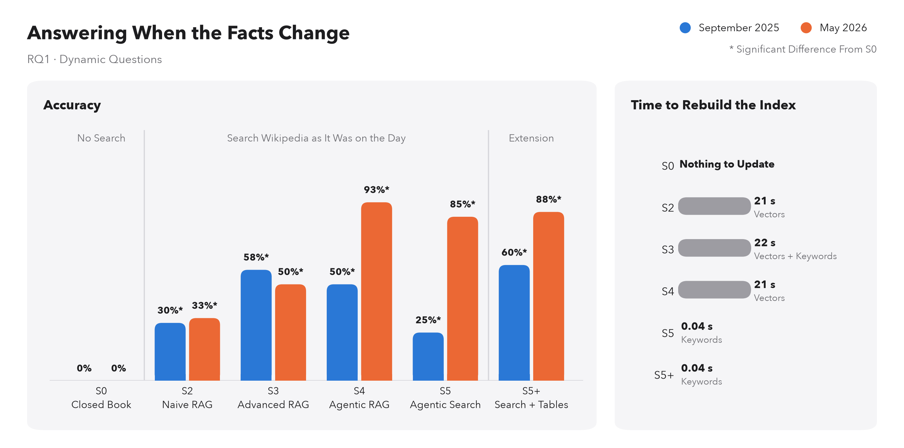
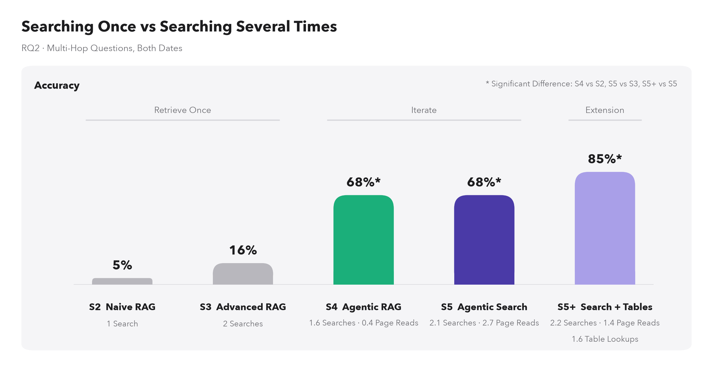
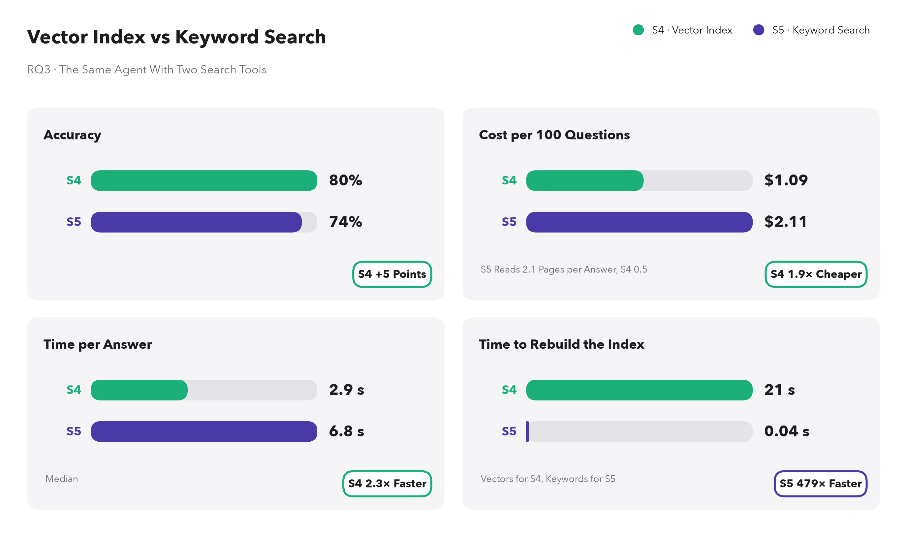
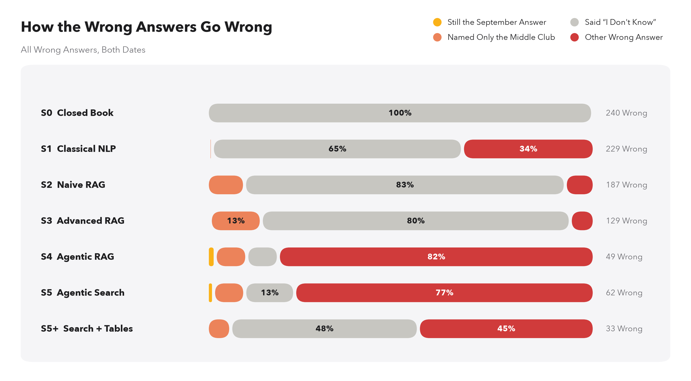
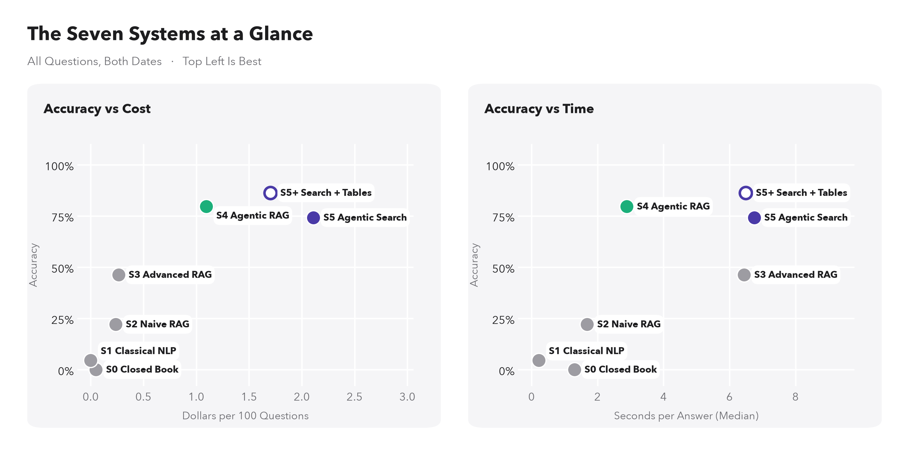

# Results

120 questions × 7 systems × 2 dates = 1680 answers. Model: claude-haiku-4-5. Graded by: claude-sonnet-5. Cost of the answers: $13.10.

## 1. Accuracy: the share of right answers (Table 6.1)

| system | Static Sep 2025 | Static May 2026 | Dynamic Sep 2025 | Dynamic May 2026 | Multi-hop Sep 2025 | Multi-hop May 2026 | All |
| --- | --- | --- | --- | --- | --- | --- | --- |
| S0 closed book | 0% | 0% | 0% | 0% | 0% | 0% | 0% |
| S1 classical NLP | 5% | 5% | 5% | 12.5% | 0% | 0% | 4.6% |
| S2 naive RAG | 30% | 30% | 30% | 32.5% | 5% | 5% | 22.1% |
| S3 advanced RAG | 70% | 67.5% | 57.5% | 50% | 15% | 17.5% | 46.3% |
| S4 agentic RAG | 100% | 100% | 50% | 92.5% | 42.5% | 92.5% | 79.6% |
| S5 agentic search | 100% | 100% | 25% | 85% | 40% | 95% | 74.2% |
| S5+ agentic search + tables | 100% | 100% | 60% | 87.5% | 72.5% | 97.5% | 86.3% |

## 2. Comparisons of Table 4.3 (Sections 6.2–6.4): significant when the 95% interval does not contain zero

The questions are drawn again, with replacement, 10,000 times; with both dates, a question keeps its two answers. The Bonferroni interval is the stricter one for the comparisons taken all together: it keeps the middle 99.67% of the differences.

| research question | comparison | questions | date | difference | 95% interval | significant | Bonferroni interval |
| --- | --- | --- | --- | --- | --- | --- | --- |
| RQ1 freshness | S2 vs S0 | dynamic | t0 | 30 points | [17.5, 45] | yes | [11.7, 52.5] |
| RQ1 freshness | S2 vs S0 | dynamic | t1 | 32.5 points | [17.5, 47.5] | yes | [12.5, 55] |
| RQ1 freshness | S3 vs S0 | dynamic | t0 | 57.5 points | [42.5, 72.5] | yes | [35, 80] |
| RQ1 freshness | S3 vs S0 | dynamic | t1 | 50 points | [35, 65] | yes | [27.5, 72.5] |
| RQ1 freshness | S4 vs S0 | dynamic | t0 | 50 points | [35, 65] | yes | [27.5, 72.5] |
| RQ1 freshness | S4 vs S0 | dynamic | t1 | 92.5 points | [82.5, 100] | yes | [77.5, 100] |
| RQ1 freshness | S5 vs S0 | dynamic | t0 | 25 points | [12.5, 37.5] | yes | [7.5, 47.5] |
| RQ1 freshness | S5 vs S0 | dynamic | t1 | 85 points | [72.5, 95] | yes | [67.5, 97.5] |
| RQ2 complexity | S4 vs S2 | multihop | both | 62.5 points | [51.3, 72.5] | yes | [46.3, 77.5] |
| RQ2 complexity | S5 vs S3 | multihop | both | 51.3 points | [40, 62.5] | yes | [33.8, 68.8] |
| RQ3 architecture | S5 vs S4 | all | both | −5.4 points | [−10.8, −0.4] | yes | [−13.8, 2.1] |
| extension | S5+ vs S0 | dynamic | t0 | 60 points | [45, 75] | yes | [37.5, 82.5] |
| extension | S5+ vs S0 | dynamic | t1 | 87.5 points | [77.5, 97.5] | yes | [70, 100] |
| extension | S5+ vs S5 | multihop | both | 17.5 points | [6.3, 27.5] | yes | [1.3, 33.8] |
| extension | S5+ vs S5 | all | both | 12.1 points | [6.7, 17.5] | yes | [3.8, 20.4] |

## 3. Time and cost per answer (Table 6.2, Section 6.4)

| system | median_seconds | dollars_per_100 | searches | page_reads | table_lookups |
| --- | --- | --- | --- | --- | --- |
| S0 | 1.30 | 0.05 | 0.00 | 0.00 | 0.00 |
| S1 | 0.22 | 0.00 | 1.00 | 0.00 | 0.00 |
| S2 | 1.69 | 0.24 | 1.00 | 0.00 | 0.00 |
| S3 | 6.45 | 0.26 | 2.00 | 0.00 | 0.00 |
| S4 | 2.89 | 1.09 | 1.37 | 0.51 | 0.00 |
| S5 | 6.75 | 2.11 | 1.95 | 2.12 | 0.00 |
| S5+ | 6.50 | 1.70 | 1.74 | 1.28 | 0.80 |

## 4. Seconds to rebuild each index when the facts change (Section 6.2, Figure 6.1)

| date | passages | BM25 | dense |
| --- | --- | --- | --- |
| t0 | 946 | 0.04 | 19.32 |
| t1 | 993 | 0.04 | 21.48 |

## 5. How the wrong answers go wrong (Section 6.5, Figure 6.5)

| system | Still the September Answer | Named Only the Middle Club | Said “I Don't Know” | Other Wrong Answer | All Wrong Answers |
| --- | --- | --- | --- | --- | --- |
| S0 | 0 | 0 | 239 | 1 | 240 |
| S1 | 1 | 2 | 148 | 78 | 229 |
| S2 | 0 | 18 | 155 | 14 | 187 |
| S3 | 1 | 17 | 103 | 8 | 129 |
| S4 | 1 | 4 | 4 | 40 | 49 |
| S5 | 1 | 5 | 8 | 48 | 62 |
| S5+ | 0 | 2 | 16 | 15 | 33 |

Still the September answer: in May, for a question whose answer has changed. Named only the middle club: a multi-hop question whose reply or searches name the club to find first (an estimate: the club's name is looked for in the text).

## 6. Repeatability: the same questions asked again (Sections 6.1 and 6.4)

20 questions, both dates. Same answer: the same text once normalized.

| system | answers | same_answer | accuracy | accuracy_again |
| --- | --- | --- | --- | --- |
| S0 | 40 | 100% | 0% | 0% |
| S1 | 40 | 100% | 7.5% | 7.5% |
| S2 | 40 | 97.5% | 27.5% | 27.5% |
| S3 | 40 | 92.5% | 45% | 45% |
| S4 | 40 | 100% | 77.5% | 77.5% |
| S5 | 40 | 92.5% | 77.5% | 72.5% |
| S5+ | 40 | 95% | 87.5% | 87.5% |

## 7. Figures 6.1–6.5 (PNG and PDF in results/figures)

